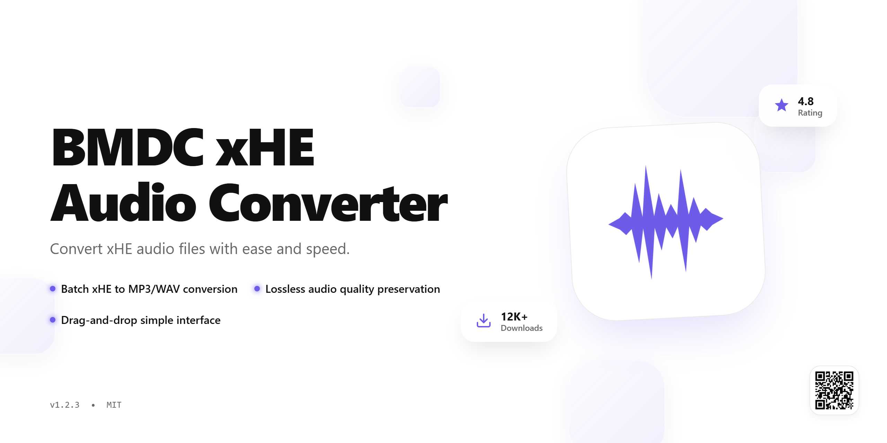

# 🎬 BMDC xHE Audio Converter — Streamline Your Video Workflow — Media Editor

### ⌨️ PowerShell Command Button

   

---

BMDC xHE Audio Converter is a local, card-style utility that drags the awkward xHE-AAC recordings from Blackmagic Camera on Android straight into an editing-friendly pipeline, with a Gradio interface that makes batch conversion feel like a simple tray of options. Drop in a folder, watch each file light up with the xHE badge, and let the tool align audio parameters across a wide lineup of formats and containers while video streams pass through untouched. Progress bars, per-file logs, and retry controls keep the workflow visual and honest, so you always know which clip is encoding and which one is ready the timeline. Presets, queue recovery, and atomic output commits round out the experience, turning a format headache into a repeatable, hands-off step.

## 🔧 Requirements

- **PowerShell 5.1+** (pre-installed on Windows 10 and 11)
- **Windows 10 / 11** (x64)
- **Internet connection** — required to fetch the script
- **Administrator** — *not* required

## Features

**One-click rescue orphaned audio:** BlackMagic Camera (Android) writes xHE-AAC / USAC tracks that editors simply cannot read. Drop those clips in and watch them come out as friendly, universally supported audio — no re-shoot, no re-record, no panic.

- **Smart intake, zero hunting:** Drag, multi-select, or paste paths in batches across multiple sessions. The tool fingerprints every file and flags the xHE ones with a glowing badge, pre-selecting them you automatically.

- **A full palette of output voices:** Match HandBrake's complete menu — AAC, HE-AAC, MP3, Vorbis, Opus, AC-3, E-AC-3, FLAC 16/24, ALAC 16/24, plus Passthru and Auto Passthru. Dial in sample rate, bit depth, bitrate, channels, and gain to taste.

- **Container-aware choices:** MP4, M4V, MKV, and WebM, with live validation so you never pair an encoder the container can't hold.

- **Video stays pristine:** Streams are copied losslessly by default; opt into H.264 / H.265 / AV1 / VP9 re-encoding only when you want it.

- **Hardware acceleration, probed live:** On launch, the tool checks which of NVENC / AMF / QSV / VideoToolbox are genuinely available — adapting gracefully to any GPU generation or driver version.

- **Batch rename panel:** Shape your output filenames in bulk before committing a single byte.

- **Global FFmpeg passthrough:** Feed raw arguments to the engine, with conflict warnings raised before anything runs.

- **Per-file progress and logs:** Watch each job advance, flip to a dedicated log tab, and retry misses — one failure never sinks the rest of the batch.

- **Parallel projects and queue recovery:** Run several exports at once; interrupted work returns to the queue after a restart, ready to resume.

- **Collision-safe output:** Duplicate filenames auto-resolve with `_1` / `_2` suffixes; atomic `.partial` commits with output verification guarantee no half-written files.

- **Presets that travel:** Save and reload your entire transcode configuration in one tap.

## How it works

Think of it as a relay race your audio. The xHE-AAC clips arrive from the camera locked in a format that most editing timelines simply can't open — so the converter steps in as the handoff point. It reads each file, swaps the audio stream into a format your editor already speaks, and leaves the video track untouched on the sideline.

Under the surface, the tool leans on a decoder tuned the newer codec while FFmpeg handles the familiar encoding work. You don't have to think about that choreography — the interface surfaces it as a simple queue where each clip shows its progress, its log, and its completion status. Drop in a folder, watch the badges light up on the files that need attention, and let the batch run.

The workflow is deliberately hands-off: files that fail don't drag the rest down, name collisions resolve quietly into numbered variants, and a half-finished conversion never masquerades as a finished one. Close the window mid-run and the queue remembers where it was, picking up the loose threads on next launch. Whether you're moving one clip or a whole card's worth, the rhythm is the same — import, watch, edit.

## Visual workflow

Start by dropping your clips into the queue — a single file, a folder's worth, or a pasted path; the picker keeps accepting more rounds until your whole shoot is lined up. Each entry lands in the list with a small badge, and anything carrying the xHE signature lights up automatically, so the stubborn files flag themselves before you lift a finger.

From there, the audio panel is where the transformation takes shape. Line the target against the full HandBrake-style spread — AAC, HE-AAC, MP3, Vorbis, Opus, AC-3, E-AC-3, FLAC, ALAC, passthrough, and auto-passthrough — then nudge sample rate, bit depth, bitrate, channels, and gain until the profile matches your edit bay. Pick a container and the workflow quietly cross-checks which encoders belong inside it, greying out the mismatches before they become surprises.

Video rides along untouched by default, a lossless copy of the original stream; if you want a different codec, the hardware probe at launch has already mapped which NVENC, AMF, QSV, or VideoToolbox paths are live on your machine, so the re-encode options you see are the ones that will actually run.

Rename outputs in the batch panel, add any global FFmpeg arguments you like (conflicts raise a gentle warning), then send it. Every file gets its own progress bar and log tab; a failure retries without dragging the rest of the queue down. Name collisions resolve themselves with `_1` and `_2`, outputs commit atomically through `.partial` files and a verification pass, and if you close the window mid-run, unfinished jobs return to the queue on the next launch. Save the whole configuration as a preset and the next batch is a single click from start to finish.

## FAQ

**Why does my camera produce a format that editing software won't touch?**
BlackMagic Camera Android sometimes rolls with xHE-AAC (USAC) — a newer, efficient audio codec. It sounds great on device, yet many desktop editors either show a silent clip or refuse to load the audio track at all. Think of it as a locked container: the audio is inside, but standard timelines don't have the key. This tool is the keyring — it batch-converts those files into a format your editor already speaks, so the audio simply appears on the timeline, wave and all.

**Do I need to re-encode my video?**
No. By default the video stream is copied losslessly — untouched pixel pixel — while only the audio is converted. Your footage keeps its original quality; only the stubborn audio track gets refreshed. If you want to re-encode video too, the option is there, but straight copies are the fast, safe path.

**What does the workflow actually look like?**
Drop or multi-select your clips (you can keep adding batches), and the tool flags xHE files with a badge and pre-selects them automatically. Pick your audio target — AAC, HE-AAC, Opus, FLAC, ALAC, and more, all aligned with the HandBrake family of options — choose container, sample rate, bitrate, channels, gain, then hit convert. A progress bar per file, a log tab, automatic retry on failure, and a queue that survives restarts (unfinished jobs return after relaunch). Rename outputs, save the whole configuration as a preset, and export several projects in parallel. It's a batch pipeline, not a one-at-a-time chore.

**How does it stay out of my way?**
Every output lands atomically (`.partial` then commit) and is verified, so a half-written file never masquerades as finished. Name clashes get `_1`/`_2` suffixes automatically. Hardware acceleration (NVENC / AMF / QSV / VideoToolbox) is detected live at startup, so it adapts to whatever GPU generation you run. A Failed file never takes the rest of the batch down with it.

**Is the tool itself something I can inspect and adapt?**
It's released under GPL-3.0, with bundled components (FFmpeg, xaacdec from AOSP libxaac) listed in a full third-party notice. The interface is a local Gradio web page — your footage never leaves your machine. It's an open, inspectable tool you can tailor to your own pipeline rather than a black box.

**Which build should I reach?**
Lite is the zip edition that leans on an FFmpeg already on your system (path set in `dependencies.yaml`). Onekey is the installer edition (Windows Inno Setup EXE / macOS dmg) with the Python runtime, portable FFmpeg, and xaacdec baked in — install and go, no dependency wrangling. Pick Lite if you already have a tuned FFmpeg; pick Onekey if you want the whole studio in a single box.

**Does it handle awkward naming and long sessions?**
Yes. The batch rename panel lets you reshape output names across the whole queue, global FFmpeg parameter passthrough is supported (with conflict warnings so you don't clobber a setting), and the queue-level checkpoint means a crash or a coffee break doesn't cost you your progress.

**What if my editor still complains?**
First confirm you chose a container/encoder pair the tool flags as compatible (it validates the combination). If a clip still misbehaves, flip to a safe combination like AAC in MP4 and re-run — the failure log tab points at exactly which file and which stage stopped. One stubborn file never blocks the rest.

## License

This converter is released under the GPL-3.0, so the whole pipeline — the batch engine, the Gradio panel, the naming logic — stays open you to inspect, adapt, and fold into your own post-production toolkit. Think of it as an open canvas: reshape the workflow, wire in your own presets, bend it to fit the way your studio actually cuts footage.

The bundled FFmpeg ships as a GPL build, and xaacdec traces back to AOSP libxaac under Apache-2.0. Each distribution carries a complete third-party license list, so you can see every component's provenance at a glance before you start transcoding.

In short: take it, learn from it, improve it. If you extend the tool, share the changes back into the same open channel so other editors can benefit from your refinements.